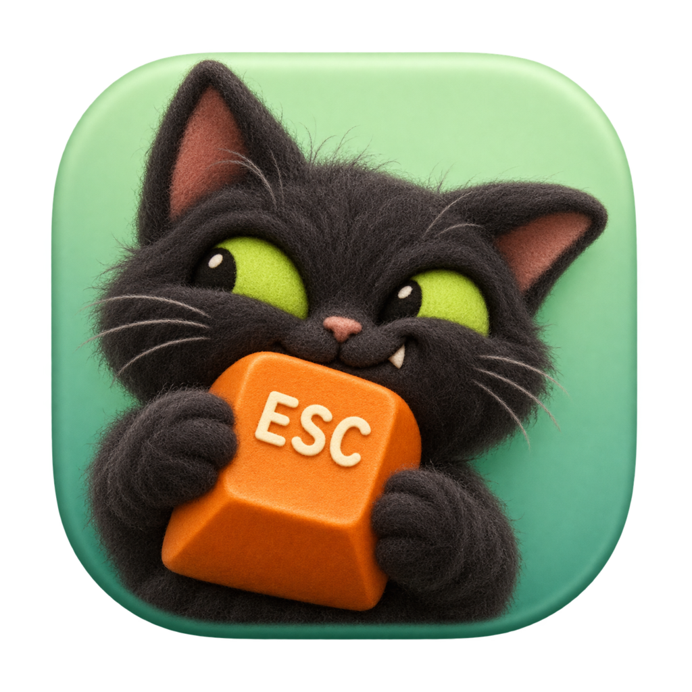

# Keycap Caper（键帽大盗）

一只会陪你敲键盘、拨鼠标的桌宠。打字时，它会用爪子敲出按键，身旁弹出键名。移动鼠标时，它的眼睛和握鼠标的爪子会跟着动。

## 下载与使用

1. 前往[最新版本](https://github.com/xiixiixixi/Keycap-Caper/releases/latest)，下载文件名带有 `macOS-universal` 的应用压缩包。支持 macOS（苹果电脑系统）13 及以上版本，苹果芯片和英特尔芯片共用一份安装包。
2. 解压后，把「Keycap Caper（键帽大盗）」拖进「应用程序」并打开。菜单栏里抱着橙色键帽的小猫就是它的入口。当前发行包采用本地签名，尚未经苹果公证，系统首次打开时可能要求确认。
3. 要让它跟随其他应用里的输入，在菜单里点「输入监控授权向导」，把向导中的应用图标拖进系统的「输入监控」列表，打开开关，按系统提示重开桌宠。向导显示「搭档已经听见键盘了」就可以开始打字。键名只用于即时动画和声音，不写入日志。

## 搭档与组合技

在「选择搭档」中切换 Smudge（墨团，小黑猫）、Pickles（酸黄瓜，小狗）、Pipkin（小陶罐，小兔）、Periscope（潜望镜，长颈鹿）、Bandit（小飞贼，小浣熊）、Paprika（甜椒，小熊猫）或 Pebble（小石子，水獭）。

| 快捷键 | 小动物的动作 |
| --- | --- |
| ⌘C（复制） | 爪旁的纸片变成两张 |
| ⌘V（粘贴） | 纸片转一圈，落回夹板 |
| ⌘X（剪切） | 剪刀把纸带剪成两截 |
| ⌘Z（撤销） / ⇧⌘Z（重做） | 怀表向后或向前转动 |
| ⌘S（保存） | 小宝箱合盖上锁 |
| ⌘F（查找） | 放大镜找到了一枚爪印 |
| ⌘A（全选） | 选框把键帽一网收齐 |

在「组合技图鉴」里可以直接试招。

## 和搭档玩

菜单栏小猫的「互动玩法」可以马上试演。试演偷键帽或钓鱼时，小浣熊、水獭会临时出场，演完就换回你选的搭档。

- **偷键帽**　选小浣熊，打完字把鼠标放远，等约十五秒。它动手以后把指针移近，就能当场抓包。
- **学节奏**　连续敲四到六下普通键，停一秒听听。搭档会用当前轴声复敲刚才的节奏，有时还会敲错再补一下。它只暂存敲击间隔。
- **滚轮钓鱼**　选水獭，向下翻几下网页，让鱼线放深，再向上翻把线收回来。鼠标滚轮和触控板都可以玩。
- **摸头和接气泡**　用指针轻轻划过搭档额头。打字时也可以看看偶尔掉下来的键名气泡，小狗会叼，兔子会顶，黑猫遇到空格会拿它当枕头。
- **麻将自摸**　选麻将轴，连续敲一阵再按回车，搭档偶尔会推倒一排小麻将。

## 获取同款轴声

第一次打开就有五种声音：四种模拟轴音和高特绿轴实录。要听佳达隆磁玉专业版的麻将音，点菜单栏小猫 →「轴体音效」→「获取原版音效…」，在「麻将音」旁点「获取」。下载后会自动切换并试听。

点「获取全部」会从各自的原声页所在的音效库取得七套个人原声：麻将音、樱桃红轴、黑轴、茶轴、青轴、水晶紫轴、东普紫轴。获取成功后，十二种声音都能在同一个菜单里切换，也可以离线使用。每行的「原声页」可以查看来源和授权。如果已从原站下载了压缩包，点「导入原包」并选中对应的轴体即可。七套录音仅保存在下载者的电脑上。[原声音效库的使用条款](https://mechvibes.com/terms)

## 更新与构建

从 2.3 开始，桌宠在启动时和运行期间约每六小时检查一次公开发布页。有新版时会显示版本说明，点「安装并重新打开」即可下载并升级。也可以随时点击菜单中的「检查更新」。安装前会核对发布签名、文件摘要、应用标识和版本。新版启动失败时会尝试恢复上一版。页面中的 `latest.json` 是应用读取的更新清单，手动安装只需下载应用压缩包。

从源码构建需要苹果的命令行开发工具。运行 `bash build.sh` 后，可在 `.build` 找到通用版应用。桌宠运行时无需安装开发工具。

正式发行包会沿用项目专属的本地签名证书，供系统在更新后认出同一个桌宠。从 2.3 或更早的临时签名版本首次升级时，系统可能会要求重新打开「输入监控」。应用更新清单另有独立的签名密钥。

维护者可以用 `CAPER_APP_SIGNER` 指定本机签名工具的绝对路径。构建脚本会把更新助手和应用的路径依次传给它。常规开发构建在缺少签名工具时使用临时签名。生成正式更新包时，脚本会校验应用标识，并将两个处理器架构的应用和更新助手证书逐一与 `Branding/AppSignerSHA256.txt` 中的指纹核对。

## 素材与署名

- 部分键盘响应代码改编自 [BongoCat-mac（敲键猫）](https://github.com/Gamma-Software/BongoCat-mac)，作者 Valentin Rudloff。仓库和应用均附 [MIT（宽松开源许可）原文](ThirdParty/BongoCat-mac-LICENSE.txt)。
- 高特绿轴的四段实录来自 Nigh 的 [OpenClickSound（开源按键音效）](https://github.com/Nigh/OpenClickSound)。发行版裁去了开头和结尾的静音，保留原作者信息。录音按 [CC BY-NC 4.0（署名、非商业使用）](https://creativecommons.org/licenses/by-nc/4.0/) 分享。[录音署名与改动说明](ThirdParty/OpenClickSound-LICENSE.txt)
